# HW4: ECR, ECS, Fargate and MapReduce

Utkarsh Sharma · Code: https://github.com/utkarshsharma19/Building-Scalable-Systems-CS6650/tree/main/hw04

Everything ran in the AWS Learner Lab in us-west-2. I built the Docker images on an M1 MacBook.

Part I is posted on Piazza in the reading folder.

## Part II: Running a service on ECS

I reused my albums server from HW2 (`part2/hello-service/`) and followed the 7 steps from the handout.

I ran into two problems:

1. The Docker build crashed during `go mod download`. My Mac is ARM and ECS needs an amd64 image, so Docker was running the Go compiler through an emulator, and it crashed there. I fixed it by building natively and cross-compiling to amd64 inside the Dockerfile (`--platform=$BUILDPLATFORM` with `GOARCH=$TARGETARCH`).
2. In zsh, `$ECR_URL:latest` turned into `hello-serviceatest`, because zsh reads `:l` as a modifier on the variable. Writing `${ECR_URL}:latest` fixed it.

Logging in to ECR and pushing the images:


Cluster and task definition (0.25 vCPU, 0.5 GB, LabRole):

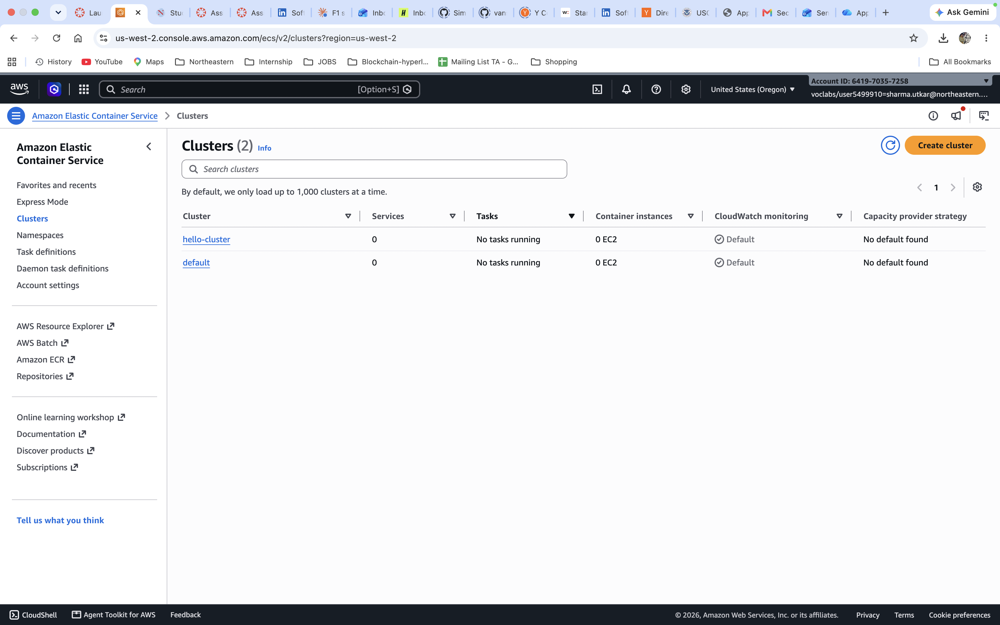
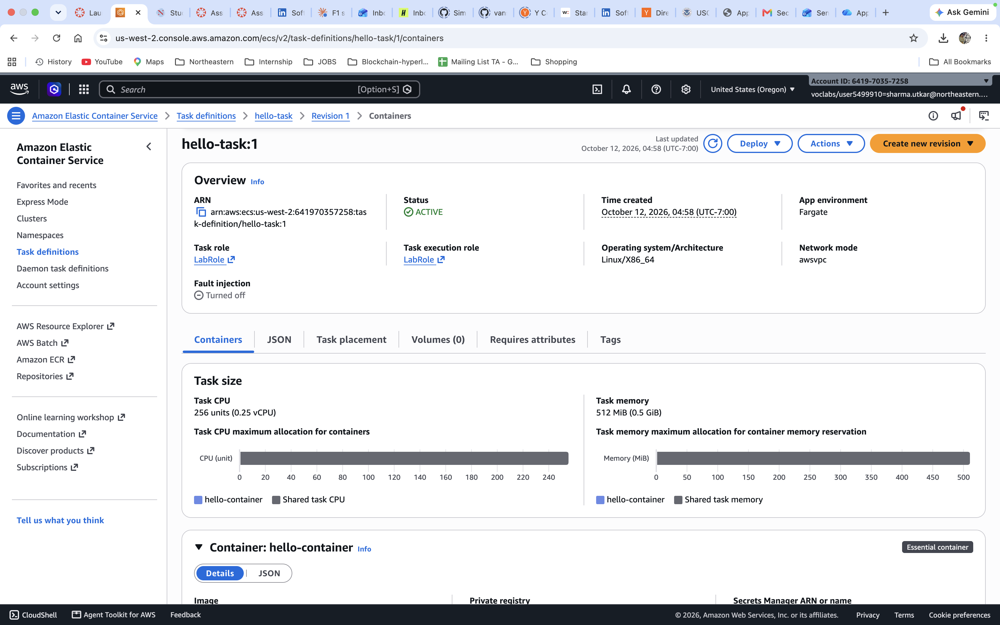

Running the task with a new security group that allows port 8080, and a public IP:

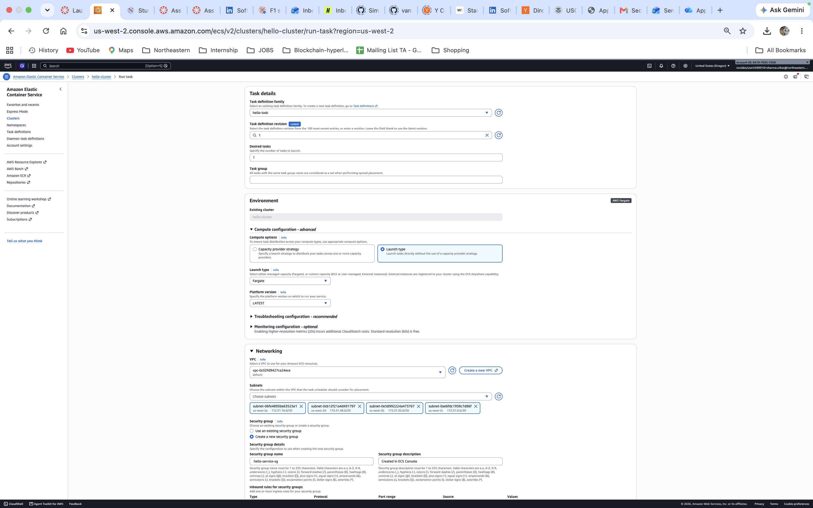
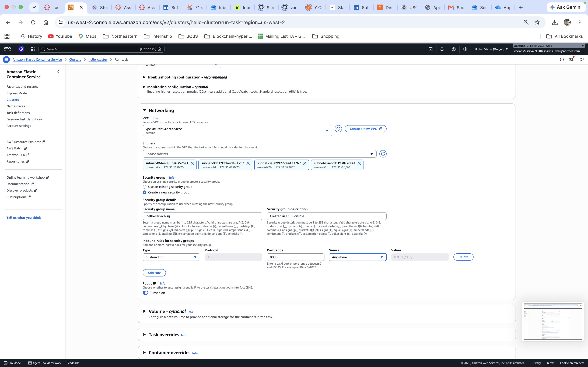
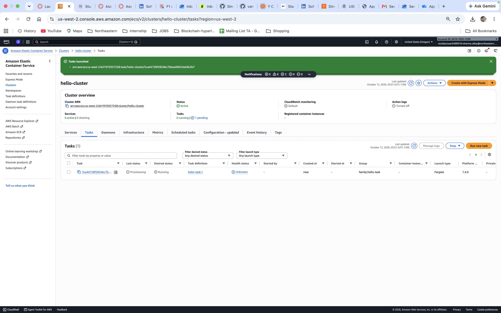
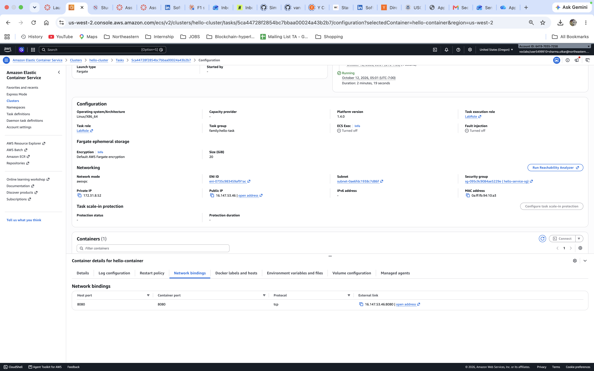

Testing with curl:

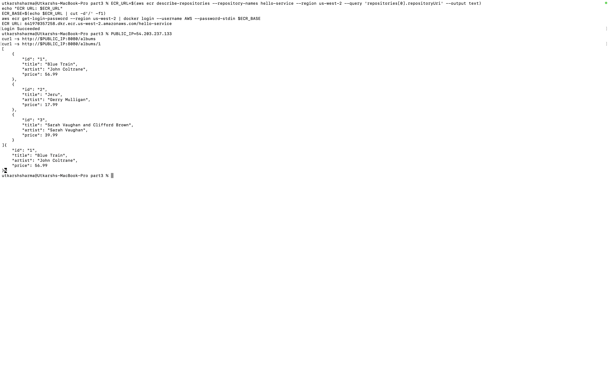

## Part III: MapReduce word count

### How it works

There are three small Go programs in `part3/cmd/`. Each one is an HTTP server on port 8080:

- **splitter**: `GET /split?url=<s3 file>&n=3` downloads the file, cuts it into 3 equal parts, uploads them to S3 and returns their URLs.
- **mapper**: `GET /map?url=<s3 chunk>` counts the words in one chunk, saves the counts as JSON in S3 and returns the URL.
- **reducer**: `GET /reduce?urls=<a,b,c>` adds up the mapper results, saves the final counts in S3 and returns the URL.

A job's files go into one folder in S3:

```
jobs/<id>/chunks/chunk-0.txt ...
jobs/<id>/mapped/chunk-0.json ...
jobs/<id>/final/counts.json
```

The splitter only cuts at a space, so no word ends up split across two chunks. The mapper and a local counter (`cmd/localcount`) use the same counting code, so I can check the result. `go test ./...` checks that splitting and then merging gives the same counts as counting the whole file.

All three services use one Dockerfile (`--build-arg SERVICE=mapper`, etc.). I pushed them to three ECR repos and made a task definition for each, with the same settings as hello-task. I ran 1 splitter, 3 mappers and 1 reducer in `hello-cluster`. The tasks use LabRole to access S3, so no keys are stored in the containers.

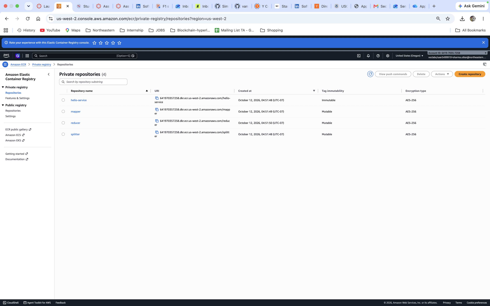

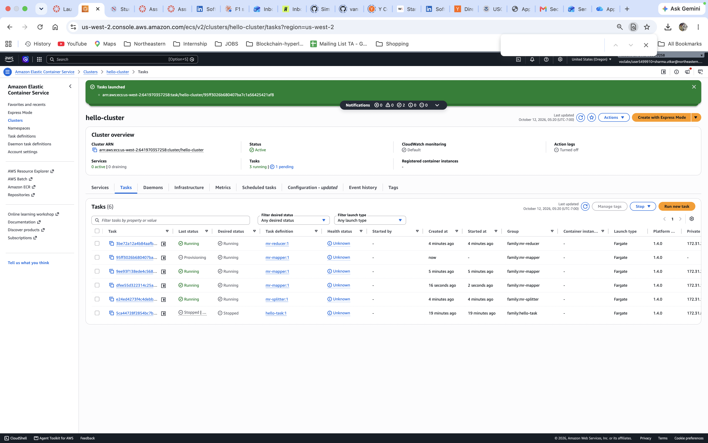

`scripts/mapreduce.py` runs a job from my laptop. It calls the splitter, sends the 3 chunks to the 3 mappers at the same time, then calls the reducer.

### Test data

I repeated Tiny Shakespeare (1.1 MB) to make 1, 5, 10, 25 and 50 MB files and uploaded them to S3.

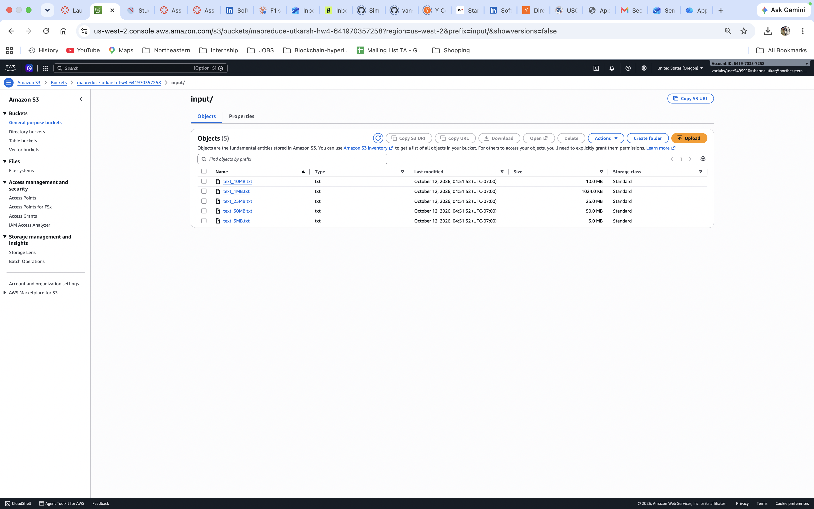

### Is it correct?

I ran a job on the 10 MB file. Then `scripts/verify.py` downloaded the final JSON and compared it with a local count of the same file. Every word matched: 1,915,891 words total, 12,374 unique.

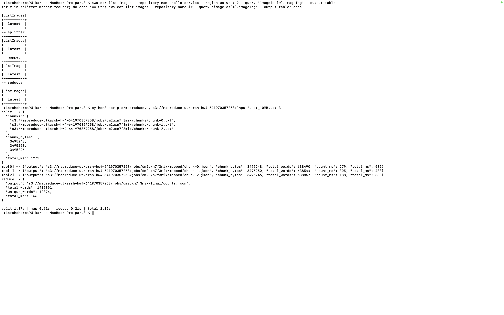
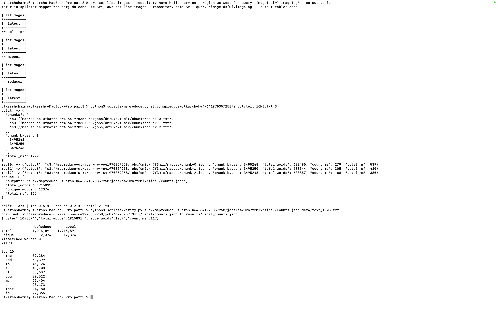

### Experiments

`scripts/experiments.py` runs each setup 3 times and uses the median. The time is measured from my laptop, from the start of the split to the end of the reduce.

**1. Does it get faster with 3 mappers?**

| File size | 1 mapper | 3 mappers | Speedup |
|---|---|---|---|
| 1 MB | 0.55 s | 0.68 s | 0.80x |
| 5 MB | 0.98 s | 0.90 s | 1.09x |
| 10 MB | 1.59 s | 1.21 s | 1.31x |
| 25 MB | 3.46 s | 2.16 s | 1.60x |
| 50 MB | 7.04 s | 3.33 s | 2.11x |

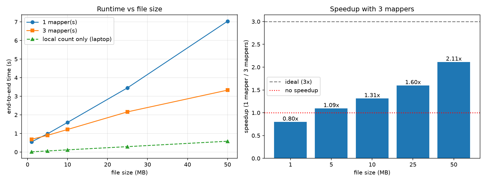

For small files, 3 mappers is slower. The counting takes almost no time, so the extra uploads and requests cost more than they save. As the file gets bigger, counting takes up more of the time and the speedup goes up, reaching 2.1x at 50 MB.

**2. Where does the time go?**

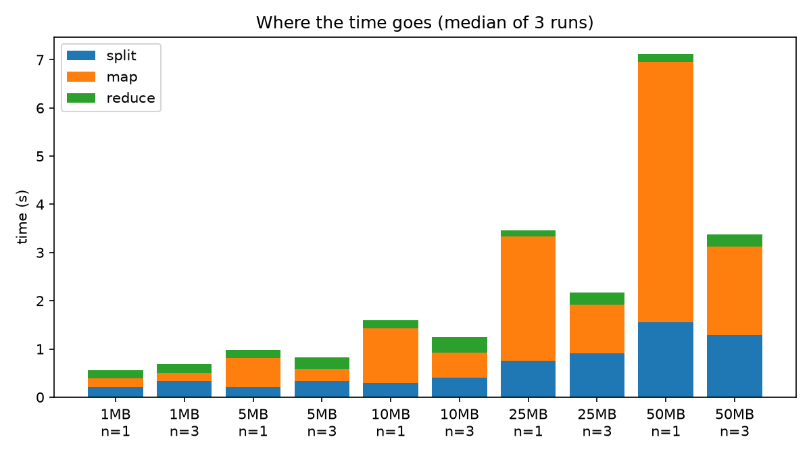

At 50 MB, the map step goes from 5.40 s to 1.83 s with 3 mappers, which is almost exactly 3x. The split step (about 1.3 s) and the reduce step (about 0.2 s) don't get faster, because there's still only one splitter and one reducer. That's why the total speedup stops at about 2x instead of 3x.

**3. Is the work balanced across the mappers?**

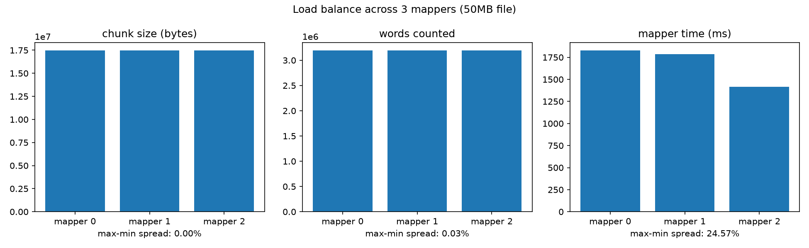

The 3 chunks were the same size to within 4 bytes, and the word counts were within 0.03% of each other. The mapper times still varied by about 25% (1.83 s, 1.79 s, 1.42 s). The work was the same, so the difference comes from the machines: each task gets a small share of a shared CPU, and S3 speed varies. The map step has to wait for the slowest mapper.

**4. What if there are more chunks than mappers?**

| Chunks | 1 | 2 | 3 | 6 | 9 |
|---|---|---|---|---|---|
| Time | 6.65 s | 4.30 s | 3.39 s | 4.11 s | 4.32 s |

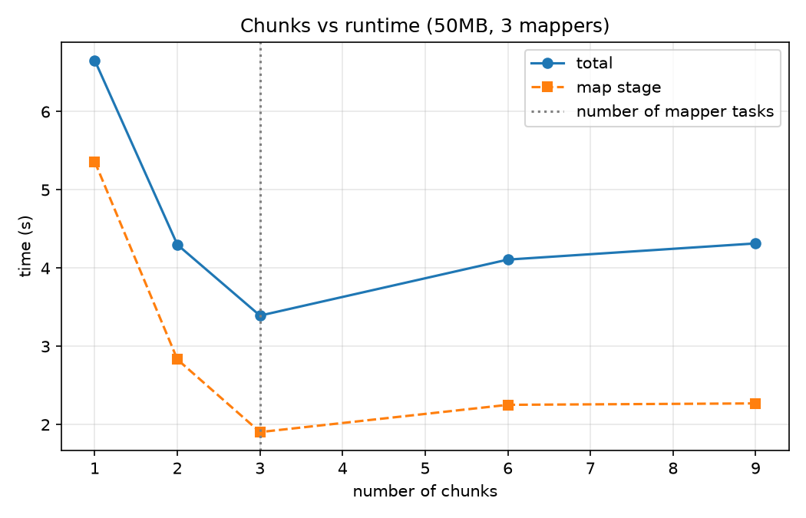

3 chunks is the fastest, one per mapper. With more chunks, each mapper just handles several at once on the same small CPU, and there are more files to move around.

### What I learned

- Splitting the work only pays off when there's enough work. For small files, network and S3 overhead decide the speed.
- The parts that don't run in parallel (one splitter, one reducer) limit the overall speedup.
- Equal work doesn't mean equal time. The slowest mapper sets the pace.
- A laptop counts 50 MB in 0.58 s. Spreading the work out only makes sense when the data is too big for one machine.

### Questions

**What if a mapper fails?** Right now the whole job fails. But the chunk is still in S3, so the coordinator could send the same chunk to another mapper. Running a chunk twice is safe because it always gives the same output.

**How to scale to 10 or 100 mappers?** Run more mapper tasks, ideally as an ECS service behind a load balancer, so the coordinator doesn't need to know every IP. After that, the splitter and reducer become the bottleneck. The splitter could just hand out byte ranges for mappers to read straight from S3, and the reducer could be split so several reducers each handle part of the words.

**What was hard about coordinating by hand?** I had to click through every task to find its public IP, and the IP changes whenever a task restarts. Once I started only 1 mapper instead of 3 and didn't notice until I listed the tasks. Nothing restarts a task that crashes. Tools like ECS services and Terraform exist to take care of this.

## How to run

```bash
cd part3
go test ./...
python3 scripts/make_data.py data/source.txt
# put the task IPs and bucket name in endpoints.json
python3 scripts/mapreduce.py s3://<bucket>/input/text_10MB.txt 3
python3 scripts/verify.py <final counts url> data/text_10MB.txt
.venv/bin/python scripts/experiments.py
```

## Cleanup

When I finished, I deleted the tasks, task definitions, cluster, ECR repos, security group and S3 bucket.
