# HW5 – Product API: Gin + Docker + Terraform/ECS + Locust + Prometheus/Grafana

Implements the **Product** endpoints of [`api.yaml`](api.yaml) in Go (Gin), deploys it to AWS ECS Fargate
with Terraform (based on the course starter repo
[RuidiH/CS6650_2b_demo](https://github.com/RuidiH/CS6650_2b_demo)), load tests it with Locust, and
observes it with Prometheus, Grafana and structured JSON logs.

## Where things are

| Path | What it is |
|---|---|
| [`src/product-service.go`](src/product-service.go) | Server: handlers, validation, in-memory store, metrics, JSON request logs |
| [`src/Dockerfile`](src/Dockerfile) | Multi-stage build → distroless image (linux/amd64 by default, for Fargate) |
| [`terraform/`](terraform/) | Infrastructure as code: ECR repo, image build/push, ECS cluster/service, SG, CloudWatch logs |
| [`locust/`](locust/) | `locustfile.py` (HttpUser), `locustfile_fast.py` (FastHttpUser), `stress_shape.py` (step ramp) |
| [`observability/`](observability/) | docker-compose with app, Prometheus, Grafana (dashboard auto-provisioned) and Locust |
| [`postman/`](postman/) | Postman collection with one request per response code |
| [`scripts/get-ip.sh`](scripts/get-ip.sh) | Prints the public IP of the running ECS task |
| [`screenshots/`](screenshots/) | All screenshots referenced below |

---

## 1. API

| Endpoint | Success | Errors |
|---|---|---|
| `GET /products/{productId}` | **200** Product JSON | **404** not found · **500** server error |
| `POST /products/{productId}/details` | **204** no body | **400** invalid input · **404** not found · **500** server error |

Every error body follows the spec's `Error` schema: `{"error": "...", "message": "...", "details": "..."}`.

Notes on how I read the spec:
- **The catalog is seeded.** The spec has no "create product" endpoint, and POST returns 404 for an unknown
  product, so POST is an *update* of an existing product. At startup the server seeds products `1..1000`
  (change with `SEED_PRODUCTS`).
- **POST validation (400):** a path ID that isn't an int32 ≥ 1, malformed JSON, a missing required field, wrong
  JSON types (e.g. `"1"` instead of `1`), constraint violations (`sku` 1–100 chars, `manufacturer` 1–200,
  `category_id`/`some_other_id` ≥ 1, `weight` ≥ 0), and a body `product_id` that differs from the path.
- **GET only lists 200/404/500**, so a GET for an ID that can't exist (e.g. `abc`) returns **404** rather
  than a 400 the spec doesn't define.
- **500:** handler panics are caught by recovery middleware and returned as an `Error` JSON 500. To trigger it on
  purpose, send the header `X-Simulate-Error: true`, which makes the handler panic and go through the same
  recovery path a real bug would.

- **Auth is not implemented.** `api.yaml` declares global `security` (`ApiKeyAuth` header `X-API-Key` or a
  `BearerAuth` JWT), but the Product endpoints list no 401/403 responses, and this assignment asks for exactly the
  listed codes. So I left auth out on purpose. Adding it would be a Gin middleware that checks the header and
  returns 401 with the `Error` schema, ideally enforced at an API gateway in front of all services.
- **Schemas:** `Product` has 6 required fields: `product_id` (int32 ≥ 1), `sku` (1–100 chars), `manufacturer`
  (1–200), `category_id` (≥ 1), `weight` (≥ 0, grams), `some_other_id` (≥ 1). `Error` = `error` code + `message`
  (required) + optional `details`.

Also exposed (not part of the spec): `GET /health` and `GET /metrics` (Prometheus).

### Data structure
`map[int32]Product` guarded by a `sync.RWMutex`:
- **O(1)** lookup and update by ID, which is exactly what both endpoints need.
- **RWMutex:** reads (the common case in a store) hold a shared lock and run in parallel. A POST takes the
  exclusive lock briefly. A bare Go map would crash with `fatal error: concurrent map writes` under concurrent
  POSTs (see HW3 `p2-03-plain-map-crash.png`).
- **Limits:** state lives in one process, so it is lost on restart and not shared between ECS tasks
  (`ecs_count > 1` would give each task its own catalog, the same "instances disagree" problem as HW2). Under
  heavy write load every writer serializes on one lock. Fixes would be lock sharding, or a real datastore
  (DynamoDB/RDS) plus a cache.

---

## 2. Run locally

Prerequisites: Go 1.27+, Docker.

```bash
# go run
cd src
go run .                     # listens on :8080

# Docker (on an Apple Silicon Mac add --build-arg ARCH=arm64 for a native, faster local image)
cd src
docker build -t product-service .
docker run --rm -p 8080:8080 product-service
```

### Examples for every response code

```bash
BASE=http://localhost:8080        # or http://<ECS-PUBLIC-IP>:8080
VALID='{"product_id":1,"sku":"ABC-123-XYZ","manufacturer":"Acme Corporation","category_id":456,"weight":1250,"some_other_id":789}'

# GET 200 – found
curl -i $BASE/products/1
# GET 404 – not found
curl -i $BASE/products/99999
# GET 500 – simulated internal error
curl -i -H 'X-Simulate-Error: true' $BASE/products/1

# POST 204 – details updated
curl -i -X POST -H 'Content-Type: application/json' -d "$VALID" $BASE/products/1/details
# POST 400 – malformed JSON
curl -i -X POST -H 'Content-Type: application/json' -d '{bad json' $BASE/products/1/details
# POST 400 – missing required fields
curl -i -X POST -H 'Content-Type: application/json' -d '{"product_id":1}' $BASE/products/1/details
# POST 400 – body product_id does not match path
curl -i -X POST -H 'Content-Type: application/json' -d "$VALID" $BASE/products/2/details
# POST 404 – product does not exist
curl -i -X POST -H 'Content-Type: application/json' \
  -d '{"product_id":99999,"sku":"A","manufacturer":"M","category_id":1,"weight":1,"some_other_id":1}' \
  $BASE/products/99999/details
# POST 500 – simulated internal error
curl -i -X POST -H 'X-Simulate-Error: true' -H 'Content-Type: application/json' -d "$VALID" $BASE/products/1/details
```

Expected responses:

| Request | Status | Body |
|---|---|---|
| `GET /products/1` | 200 | `{"product_id":1,"sku":"SKU-00001","manufacturer":"Acme Corporation","category_id":2,"weight":101,"some_other_id":2}` |
| `GET /products/99999` | 404 | `{"error":"NOT_FOUND","message":"Product not found","details":"no product with ID 99999"}` |
| `GET` + `X-Simulate-Error` | 500 | `{"error":"INTERNAL_ERROR","message":"Internal server error"}` |
| `POST` valid body | 204 | *(empty)* |
| `POST` `{bad json` | 400 | `{"error":"INVALID_INPUT","message":"Request body is not a valid Product","details":"invalid character 'b' ..."}` |
| `POST` `{"product_id":1}` | 400 | `{"error":"INVALID_INPUT","message":"The provided input data is invalid","details":"sku is required"}` |
| `POST /products/2/details` with id 1 | 400 | `{"error":"INVALID_INPUT",...,"details":"body product_id 1 does not match path productId 2"}` |
| `POST /products/99999/details` | 404 | `{"error":"NOT_FOUND","message":"Product not found","details":"no product with ID 99999"}` |
| `POST` + `X-Simulate-Error` | 500 | `{"error":"INTERNAL_ERROR","message":"Internal server error"}` |

Postman: import [`postman/product-api.postman_collection.json`](postman/product-api.postman_collection.json)
and set the `baseUrl` collection variable (`http://localhost:8080` or the ECS IP).

Screenshots:

| Code | Screenshot |
|---|---|
| GET 200 | 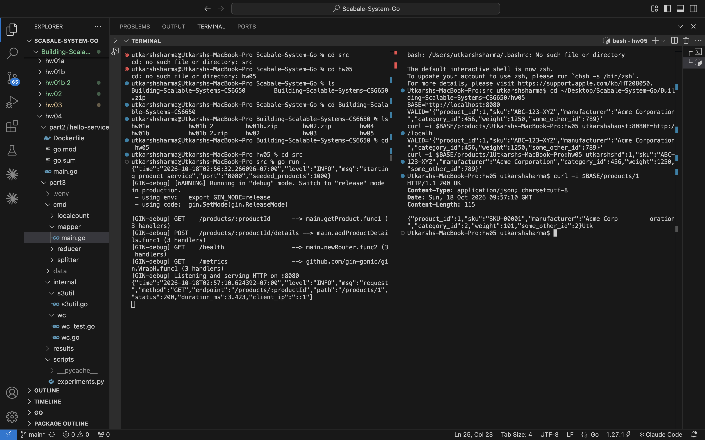 |
| GET 404 | 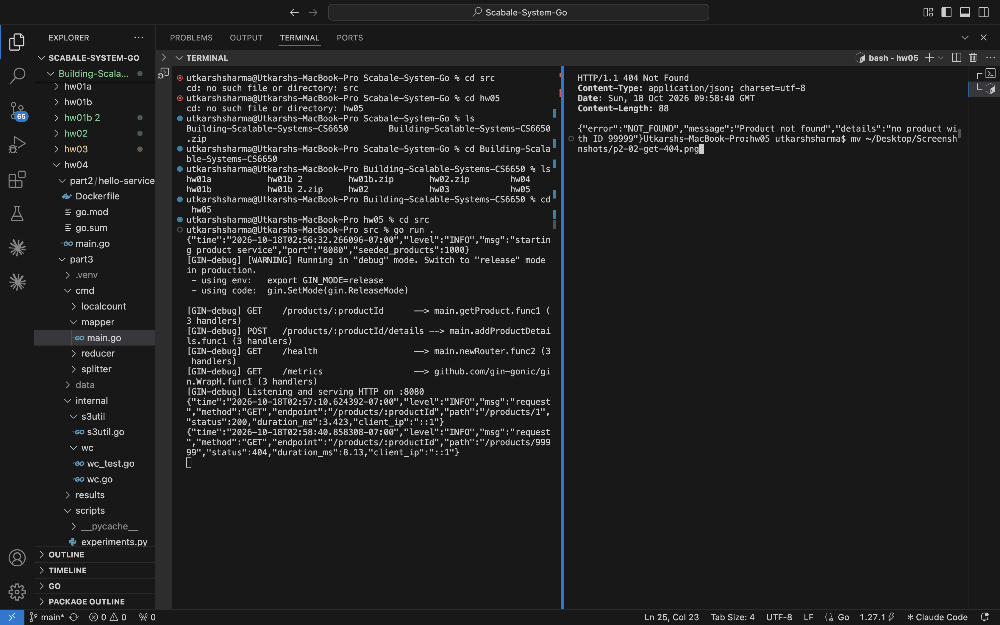 |
| GET 500 | 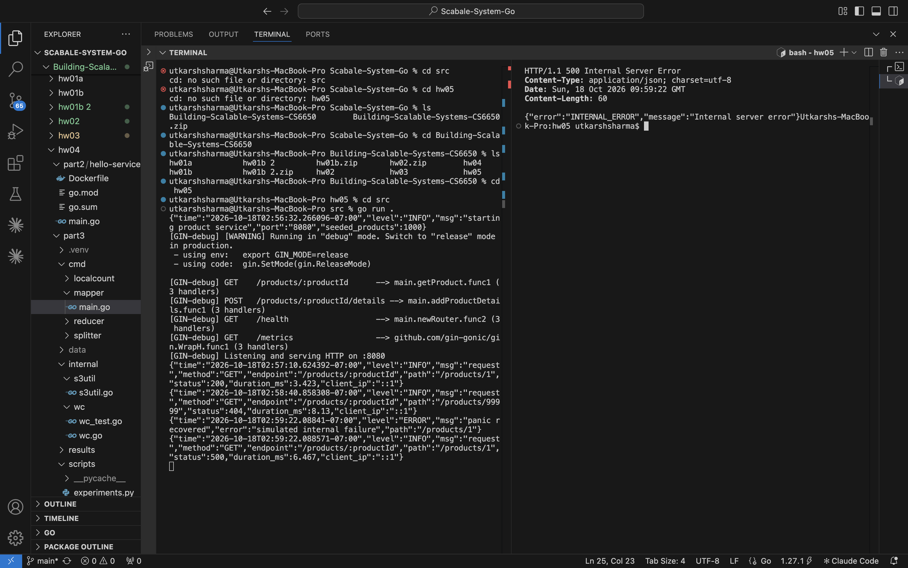 |
| POST 204 | 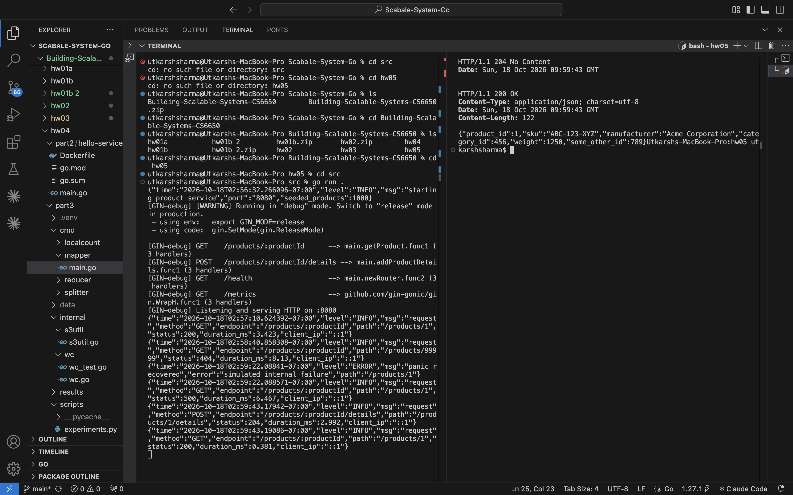 |
| POST 400 | 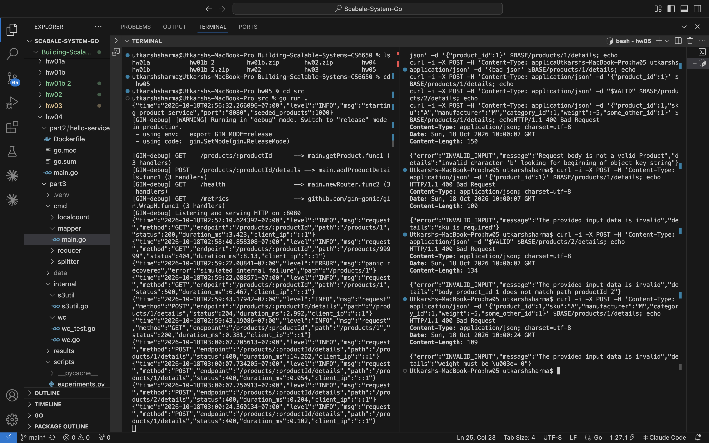 |
| POST 404 | 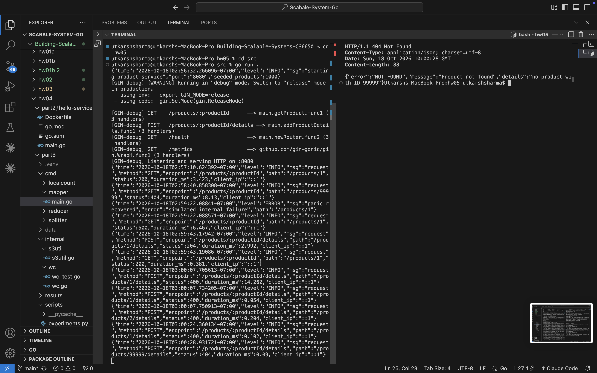 |
| POST 500 | 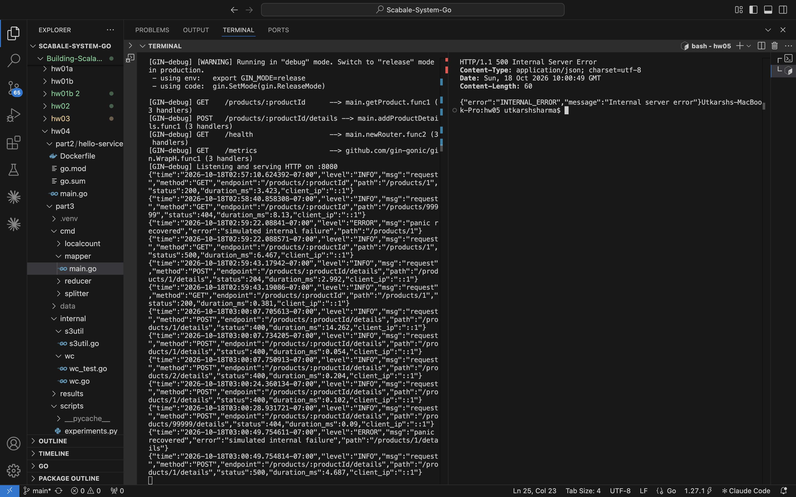 |
| `go run` + Docker | 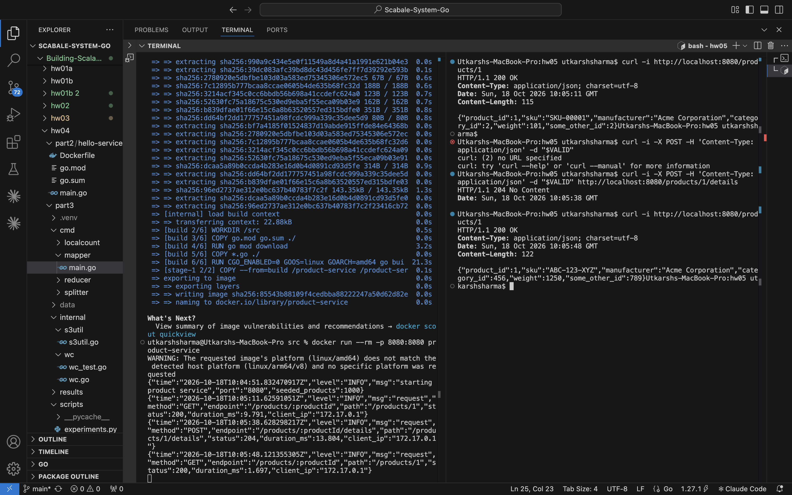 |

---

## 3. Deploy to AWS ECS with Terraform (on any machine)

**Prerequisites:** [Terraform](https://developer.hashicorp.com/terraform/install) ≥ 1.5,
[AWS CLI v2](https://docs.aws.amazon.com/cli/latest/userguide/getting-started-install.html), and Docker
running (Terraform builds and pushes the image through the local Docker daemon). You also need an AWS
Learner Lab account (the config uses the existing `LabRole` IAM role).

```bash
git clone https://github.com/utkarshsharma19/Building-Scalable-Systems-CS6650.git
cd Building-Scalable-Systems-CS6650/hw05

# 1. Credentials: copy them from Learner Lab → "AWS Details"
aws configure                                   # access key, secret key, region us-west-2, output json
aws configure set aws_session_token <SESSION-TOKEN>
aws sts get-caller-identity                     # sanity check

# 2. Point Terraform's Docker provider at your Docker daemon. Docker Desktop on macOS listens on
#    ~/.docker/run/docker.sock, not /var/run/docker.sock, so without this you get
#    "Error pinging Docker server". (Linux users can skip this.)
export DOCKER_HOST=unix://$HOME/.docker/run/docker.sock

# 3. Build, push and deploy (creates ECR repo, builds src/Dockerfile, pushes, starts ECS Fargate service)
cd terraform
terraform init
terraform apply -auto-approve

# 4. Get the task's public IP (wait ~30–60s for the task to reach RUNNING)
cd ..
./scripts/get-ip.sh
IP=$(./scripts/get-ip.sh)
curl -i http://$IP:8080/products/1

# 5. Tear everything down when finished
cd terraform && terraform destroy -auto-approve
```

Variables you can override (`terraform/variables.tf`): `aws_region` (us-west-2), `service_name`,
`ecr_repository_name`, `container_port` (8080, and it must match the port the server listens on), `ecs_count`,
`log_retention_days`. Example: `terraform apply -var ecs_count=2`.

Server logs (the JSON request lines) go to CloudWatch log group `/ecs/product-service`:
`aws logs tail /ecs/product-service --follow`.

### What each Terraform file does

| File | Role |
|---|---|
| `provider.tf` | Declares the AWS and Docker providers. Fetches an ECR auth token so the Docker provider can push to ECR. |
| `variables.tf` | Inputs that change between environments (region, names, port, task count, log retention). |
| `main.tf` | Root module: wires the 4 child modules together, looks up `LabRole`, builds and pushes the image (`docker_image` / `docker_registry_image`). |
| `modules/network` | Default VPC and subnets (data sources), plus a security group that opens `container_port`. |
| `modules/ecr` | The ECR repository the image is pushed to. |
| `modules/logging` | CloudWatch log group for container stdout. |
| `modules/ecs` | ECS cluster, Fargate task definition (256 CPU / 512 MiB, awslogs), and service with a public IP. |
| `outputs.tf` | Cluster and service names, used by `scripts/get-ip.sh`. |

Data flows through them like this: `variables.tf` → `main.tf` passes variables into the modules →
module outputs (`subnet_ids`, `repository_url`, `log_group_name`, …) feed other modules' inputs →
`outputs.tf` exposes the values a user needs.

### What I changed from the starter repo
1. `src/`: replaced `main.go` (the albums server) with `product-service.go`, `go.mod`, `go.sum` and my Dockerfile.
2. **Dockerfile pins `linux/amd64`.** Terraform builds the image on my Apple Silicon Mac, which would produce an
   arm64 image that fails on x86 Fargate with `exec format error`.
3. `main.tf`: the ECS task uses the **image digest** (`repo@sha256:…`) instead of `:latest`, and `docker_image`
   has a `triggers` hash of `src/`. A code change therefore rebuilds the image, creates a new task definition
   and redeploys the service. With a fixed `:latest` reference, Terraform sees no change in the task
   definition, so a code change alone would not roll out.
4. `modules/ecr`: `force_delete = true` so `terraform destroy` works while the repo still contains images.
5. `variables.tf`: renamed service and ECR repo to `product-service`.
6. Added `scripts/get-ip.sh`, which wraps the starter README's long `aws ecs`/`aws ec2` command.
7. Documented `export DOCKER_HOST=...` (step 2 above). On macOS, Docker Desktop's socket isn't at the
   `/var/run/docker.sock` path the Terraform Docker provider expects.

How I adapted the starter: I copied its contents into `hw05/` of my course repo (one folder per homework)
rather than keeping a separate GitHub fork, and kept its module layout unchanged.

Gotcha for macOS users: this repo lives under `~/Desktop`, which iCloud syncs. With "Optimize Mac Storage",
iCloud offloads files, and Docker bind mounts then fail with `OSError: [Errno 35] Resource deadlock avoided`.
That is why `locust/` and `observability/` copy their config into images (`Dockerfile`, `Dockerfile.*`) instead
of mounting it.

Server listens on `8080` (`PORT` env, default 8080) = `container_port` default.

Screenshots:

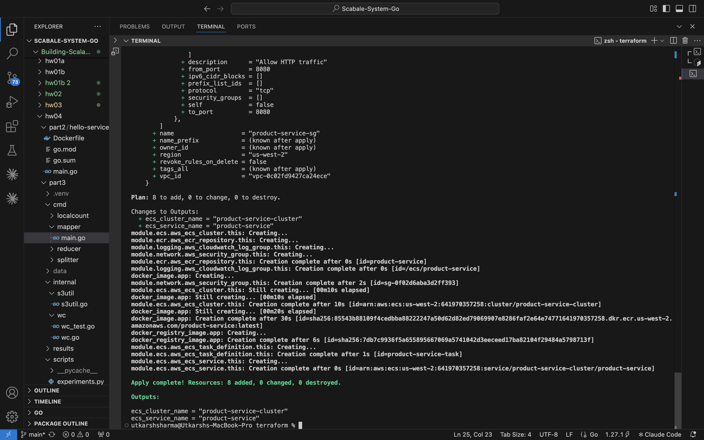
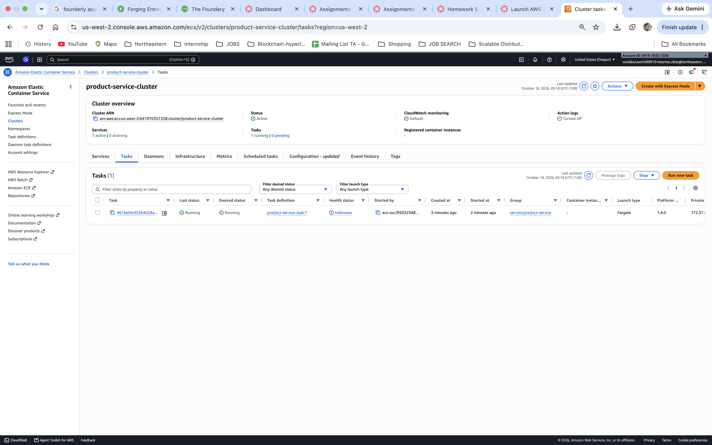
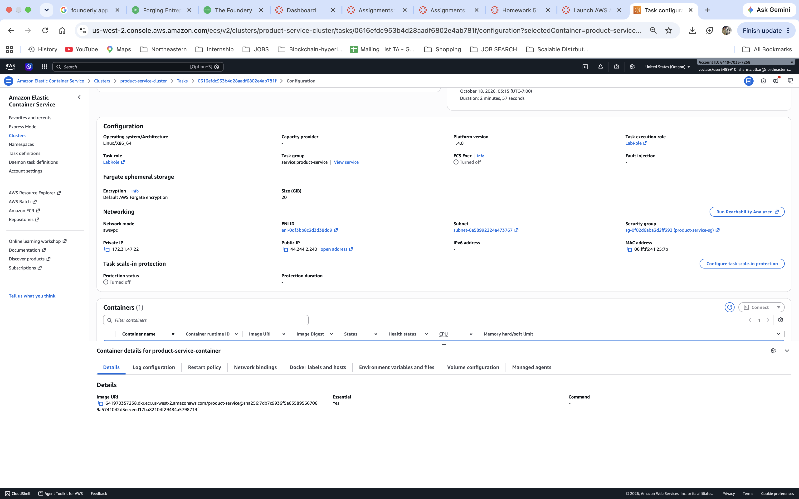
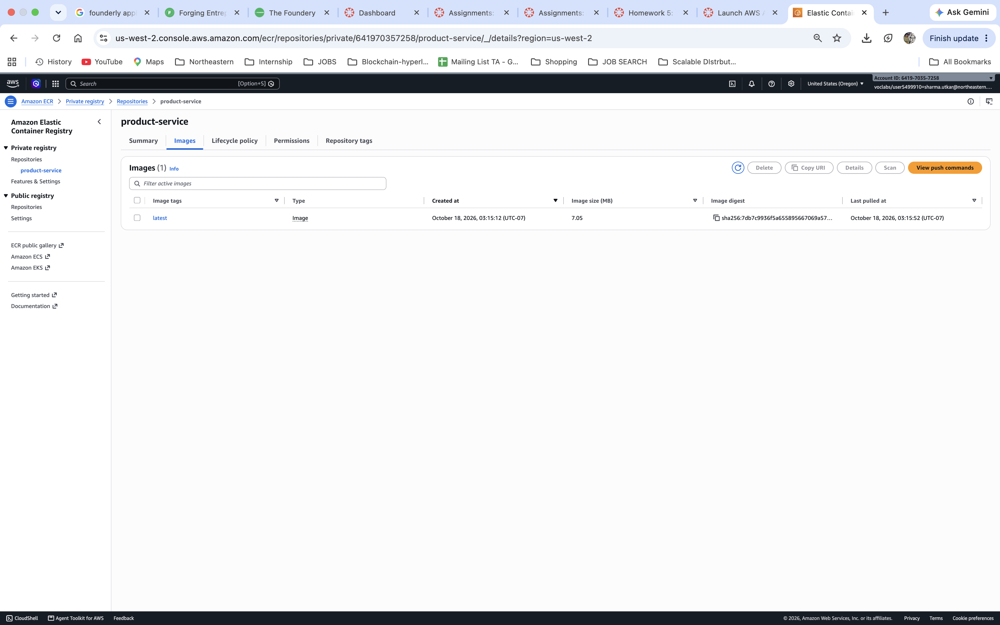
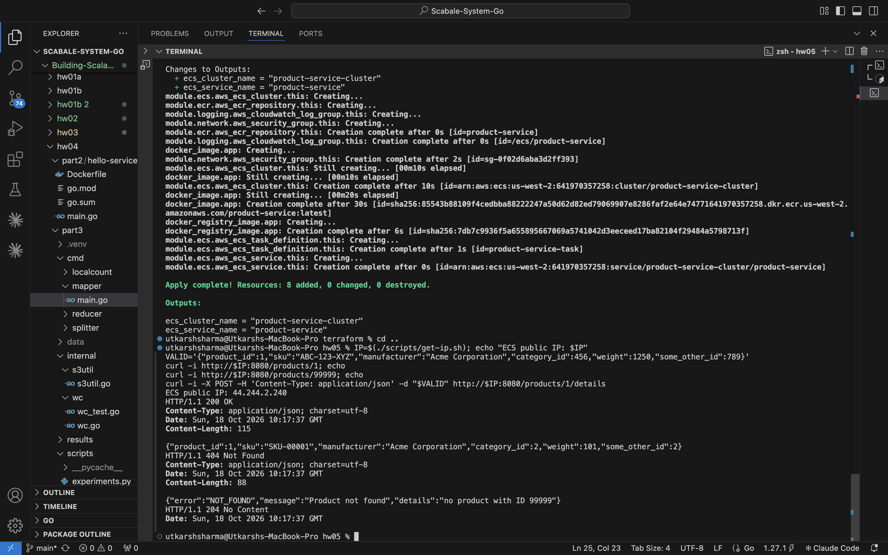

---

## 4. Load testing (Locust)

```bash
cd locust
# Against ECS, with 4 distributed workers (UI: http://localhost:8089)
TARGET_HOST=http://$IP:8080 docker compose up --build --scale worker=4
LOCUSTFILE=locustfile_fast.py TARGET_HOST=http://$IP:8080 docker compose up --build --scale worker=4
# Step-ramp stress test (50 → 2000 users, +1 step/minute)
LOCUSTFILE=locustfile_fast.py,stress_shape.py TARGET_HOST=http://$IP:8080 docker compose up --build --scale worker=4
```

### Test design
- **Request mix: 70% GET existing / 20% POST details / 10% GET missing (404).** Browsing dominates writes in
  any store. The 404s model bad links or deleted items and give the error panels something to show.
- **IDs are random over the 1000 seeded products,** so no single hot key.
- **`wait_time = between(0, 0.1)`** keeps the pressure high so we find the server's limit, not the users' think time.
- **Runs:**

| Run | Users | Spawn rate | Duration | User class | Purpose |
|---|---|---|---|---|---|
| Baseline | 10 | 2/s | 2 min | HttpUser | Normal latency with no contention |
| Compare A | 200 | 20/s | 3 min | HttpUser | Client comparison |
| Compare B | 200 | 20/s | 3 min | FastHttpUser | Client comparison (same config) |
| Stress | 50→2000 step | 50/s | 7 min | FastHttpUser | Find the breaking point |

### Results
All runs: Locust in Docker on my MacBook (4 workers) → ECS Fargate task (0.25 vCPU / 512 MiB) in us-west-2.
ECS CPU is CloudWatch `CPUUtilization` for the service (1-minute average).

| Run | Steady RPS | p50 (ms) | p95 (ms) | p99 (ms) | Failures | ECS CPU |
|---|---|---|---|---|---|---|
| Baseline (HttpUser, 10u) | ~115–125 | 26 | 39 | 85 | 0 (0%) | ~13% |
| HttpUser, 200u | ~2,250 | 33 | 65 | 100 | 0 (0%) | ~97% |
| FastHttpUser, 200u | ~2,300 | 33 | 61 | 96 | 0 (0%) | ~97% |
| Stress (FastHttpUser, 50→2000u) | **plateau ~3,400–3,500** | 180 overall, ~500 at 2000u | 650 overall, ~900–1000 at 2000u | 950 | 0 (0%) | **100%** from 500u on |

Stress test, per step (read from the Locust charts plus CloudWatch):

| Users | RPS | p50 (ms) | p95 (ms) | ECS CPU |
|---|---|---|---|---|
| 50 | ~600 | ~30 | ~50 | ~45–60% |
| 100 | ~1,200 | ~35 | ~60 | ~75% |
| 250 | ~2,650 | ~45 | ~90 | ~99% |
| 500 | ~3,350 | ~100 | ~220 | 100% |
| 1000 | ~3,450 | ~220 | ~500 | 100% |
| 1500 | ~3,500 | ~350 | ~700 | 100% |
| 2000 | ~3,450 | ~500 | ~900–1000 | 100% |

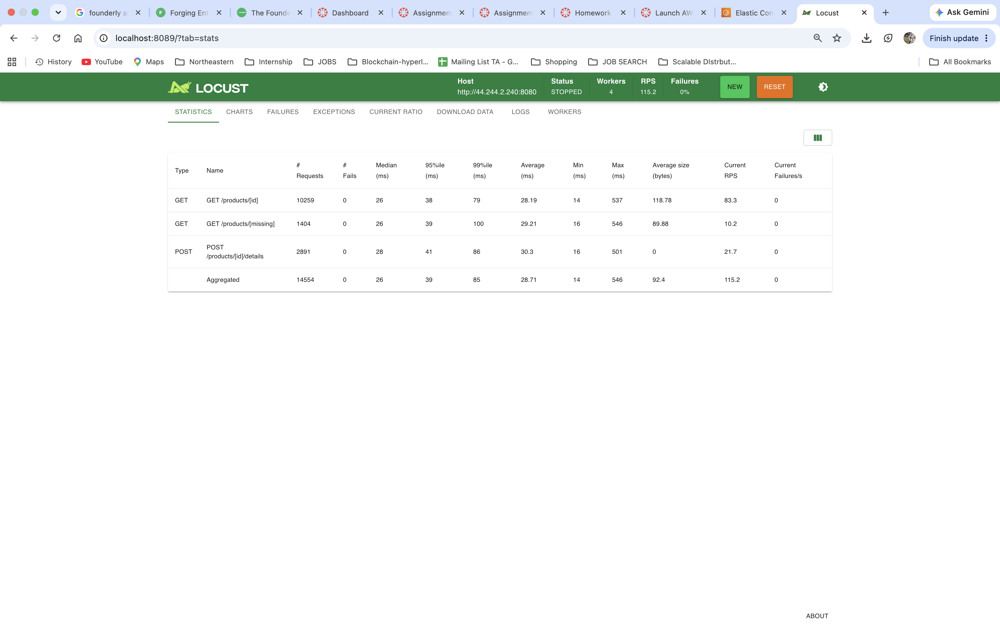
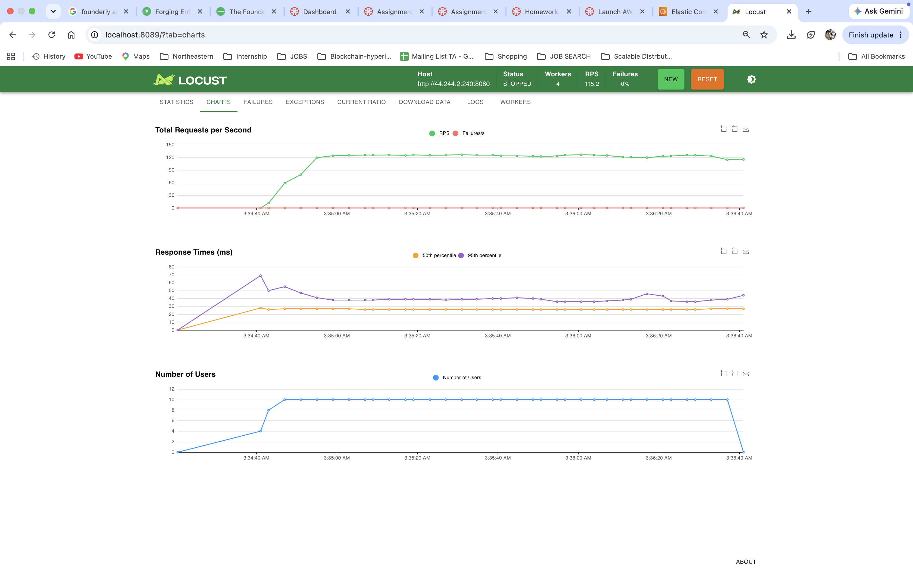
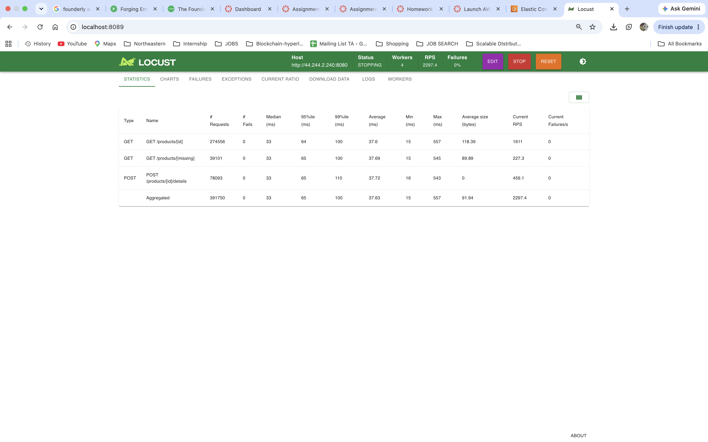
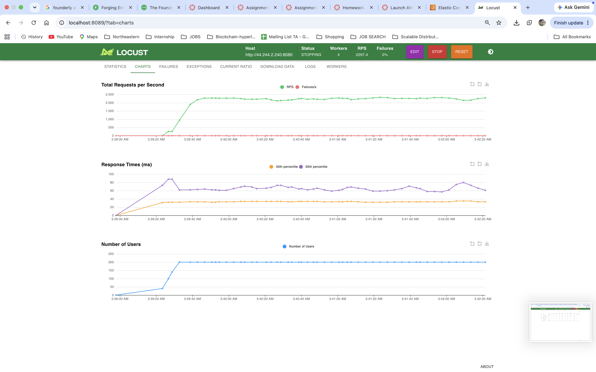
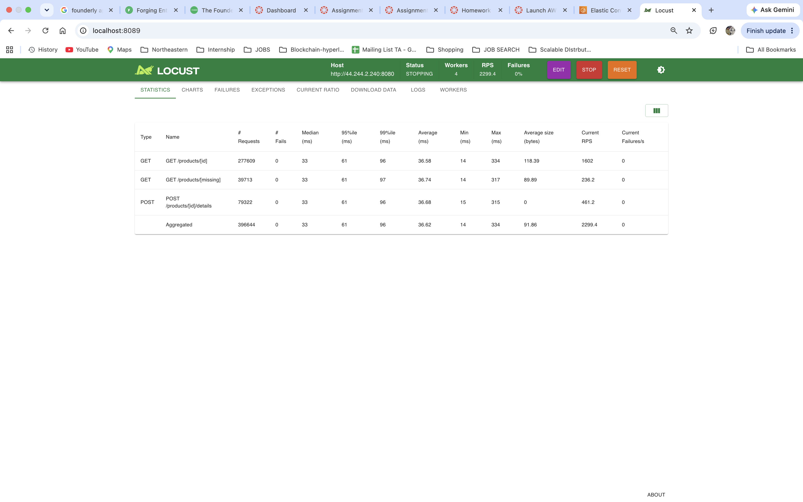

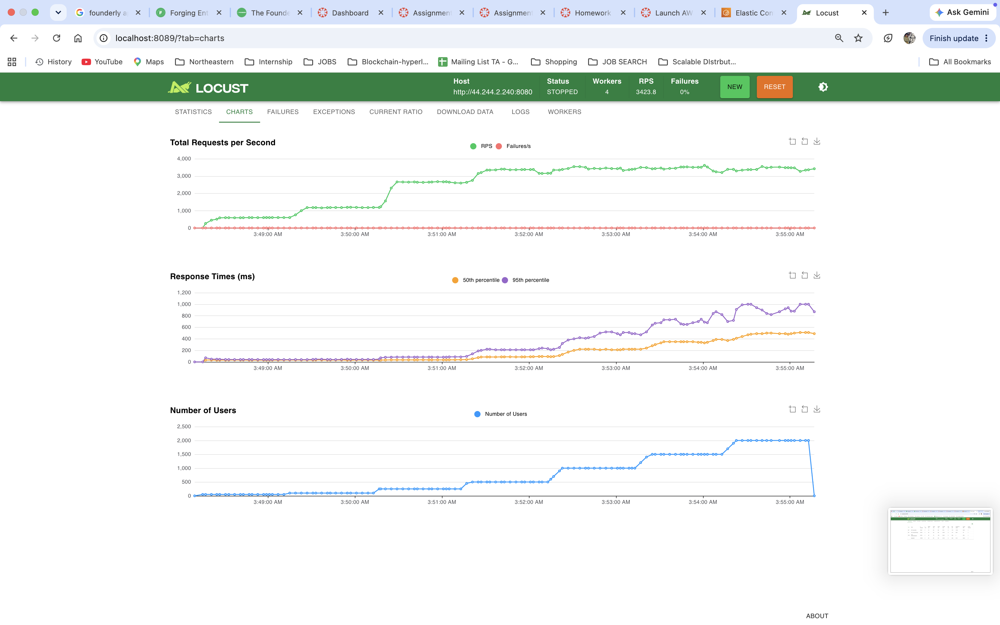
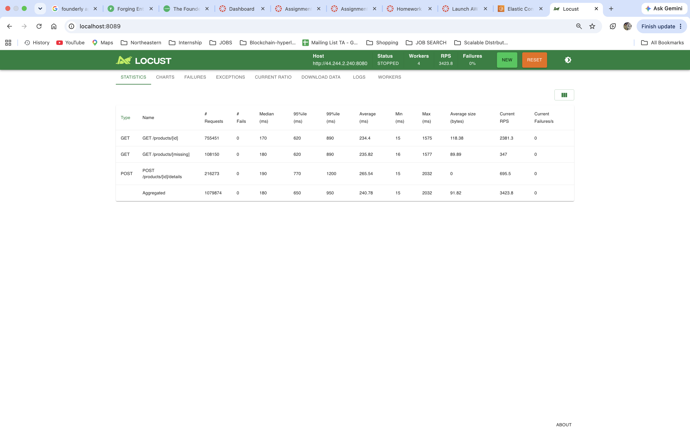

**Where it started to struggle:** at about **250–500 users**. Up to 250 users, RPS grows roughly linearly with
users (600 → 1,200 → 2,650) and latency stays near the network round trip (~30–45 ms). From 500 users on, **RPS
flattens at ~3,400–3,500** while the median rises from ~100 ms to ~500 ms and p95 approaches 1 s. At the same
moment the Fargate task's CPU is pinned at **100%**. This is a textbook saturation curve. The task has only
0.25 vCPU, so the Go server can only finish ~3.5k requests per second. Extra users don't add throughput; their
requests just wait (in the kernel accept queue and the Go scheduler run queue), so latency grows instead.
Little's Law confirms it: throughput = users / (response time + think time) = 2000 / (0.5 s + 0.05 s) ≈ 3,600
req/s, which matches the observed plateau. Notably, there were **0 failures** even at 2000 users: the server
degraded by getting slower, not by dropping requests. Failures would appear once latency exceeds client
timeouts or the accept backlog overflows.
Fixes, in order of effort: a bigger task (`cpu = 1024` in `modules/ecs`), more tasks behind a load balancer
(`ecs_count` + an ALB; this needs shared storage first, see the data-structure limits above), and CPU-based
autoscaling.

### Tradeoffs
- **Which operations are most common?** Reads (product page views) far outnumber writes (catalog updates),
  often 100:1 or more. That favours a structure optimized for concurrent reads: a hash map with an `RWMutex`
  lets reads proceed in parallel, and only the rare write is exclusive. For a write-heavy workload I would
  shard the map (N maps with N locks, keyed by `id % N`) or use `sync.Map`, which suits read-mostly
  keys that are written once. At real scale the map becomes a cache (Redis) in front of a database, because
  reads are cacheable and writes need durability.
- **HttpUser vs FastHttpUser: no real difference in my runs.** Same 200 users, same 3 minutes: HttpUser got
  ~2,250 RPS (p50 33 / p95 65 / p99 100 ms) and FastHttpUser ~2,300 RPS (p50 33 / p95 61 / p99 96 ms), with
  0 failures for both. **Why:**
  - *In theory* FastHttpUser should be much faster. `HttpUser` uses `python-requests`, which is feature-rich
    but spends a lot of Python CPU per request (Session/Response objects, urllib3 pooling). `FastHttpUser`
    uses `geventhttpclient`, a lean client built for gevent's cooperative sockets; Locust's docs claim
    roughly 4–5× more requests per second per CPU core. That only matters **when the load generator is the
    bottleneck**.
  - *In my runs the load generator wasn't the bottleneck.* Four Locust workers handle ~2,300 RPS (~575 RPS
    each) easily, and Locust never printed its "CPU usage above 90%" warning. Meanwhile the **server** was at
    ~97% CPU in both runs. Both clients hit the same ceiling: the 0.25 vCPU Fargate task.
  - The test is also closed-loop: each user waits for a response, then 0–100 ms, before the next request. So
    RPS ≈ users / (latency + think time) = 200 / (0.033 s + 0.05 s) ≈ 2,400. That is set by network RTT and
    user count, not by how efficient the client is. FastHttpUser's small edge (slightly lower p95/p99, lower
    max latency of 334 vs 557 ms) is its lower per-request overhead on the client side.
  - To *see* the difference, make Locust the bottleneck: run 1 worker instead of 4, or point it at a much
    bigger server. With HttpUser the worker would hit 100% CPU first, and FastHttpUser would push several
    times more RPS from the same worker. That matches what I saw in HW3, where a single worker with HttpUser
    was CPU-bound.

---

## 5. Observability (local)

```bash
cd observability
docker compose up --build --scale worker=2        # Apple Silicon: ARCH=arm64 docker compose up --build --scale worker=2
# Logs: docker compose logs -f --no-log-prefix app
```

- Grafana: <http://localhost:3000>, dashboard **"Product API - RED"** (auto-provisioned, no login)
- Prometheus: <http://localhost:9090> · Locust: <http://localhost:8089> (host preset to the app) · raw metrics: <http://localhost:8080/metrics>

The procedure: leave it **idle ~3 min**, then run Locust (**loaded ~5 min**), stop it, and screenshot the
dashboard with the time range covering both.

**Why this is a local run, not the ECS run from Part IV:** the assignment keeps Prometheus and Grafana local
("not deploying it to AWS"), and a local Prometheus can't scrape a Fargate task without service discovery.
So I replayed the **same Part IV test** (same `locustfile.py`: same 70/20/10 mix and wait time) against the
app running in this compose stack, and recorded idle vs loaded there. The deployed ECS task emits the same
JSON request logs to CloudWatch (`aws logs tail /ecs/product-service`), so the logs side also works in the
cloud.

### Metrics (in `product-service.go`)
| Signal | Metric | Panel query |
|---|---|---|
| **R**ate | counter `http_requests_total{method,endpoint,status}` | `sum by (method,endpoint) (rate(http_requests_total[$__rate_interval]))` |
| **E**rrors | counter `http_errors_total{method,endpoint,status}` (non-2xx) | `100 * sum(rate(http_errors_total[...])) / sum(rate(http_requests_total[...]))` |
| **D**uration | histogram `http_request_duration_seconds{method,endpoint}` | `histogram_quantile(0.95, sum by (le) (rate(..._bucket[...])))` (also p50/p99) |

The labels use the **route template** (`/products/:productId`), not the raw path, so 10 million product IDs
don't create 10 million time series. Histogram buckets start at 100µs because the in-memory handlers are far
faster than the default 5ms first bucket.

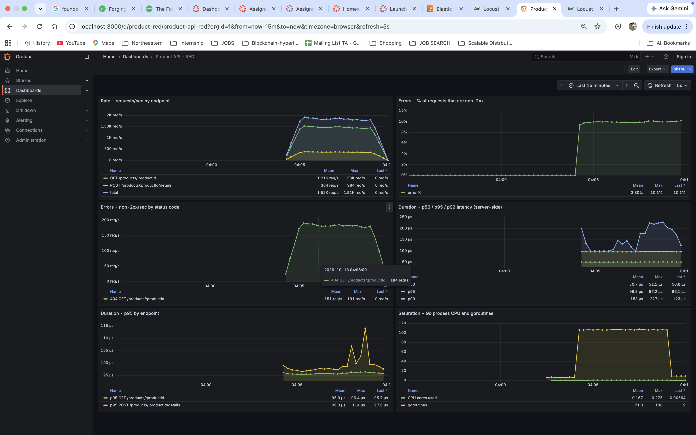

**What it shows** (local run: about 3 min idle, then Locust with 100 users / 2 workers from 04:04 to 04:09, then idle again):

| Panel | Idle | Loaded |
|---|---|---|
| Rate | 0 req/s (no series at all) | **~1.9K req/s total**: GET ~1.5K, POST ~380 |
| Error % | 0% | **~10%**: exactly the 10% of Locust tasks that look up a missing product (404) |
| Errors by status | nothing | only `404 GET /products/:productId`, ~190 req/s; no 400s or 500s |
| Duration p50 / p95 / p99 | no data | **~51 µs / ~97 µs / ~150–230 µs** server-side |
| Saturation | ~9 goroutines | ~105 goroutines (one per open keep-alive connection plus runtime) |

What it tells me:
- **The server isn't the bottleneck locally.** Server-side p95 is under 0.1 ms, while Locust reported a
  median of 1 ms and a p95 of 9 ms from the client side (see the Locust screenshots below). So almost all of
  that latency is Docker networking and the load generator, not the handler. On ECS the same handlers took
  ~33 ms end to end, which is nearly all network RTT plus queueing on the 0.25 vCPU task.
- **The error % is "expected" errors.** It sits at exactly 10% and the status panel shows only 404s, the
  missing-product lookups. A dashboard that only showed a total error % would hide that distinction, which is
  why the per-status panel exists.
- **Histogram caveat:** the Prometheus p50 of ~51 µs is an interpolation artifact. My smallest bucket is
  100 µs, and `histogram_quantile` assumes values are spread evenly inside a bucket, so it can only say
  "somewhere in 0–100 µs". The logs record exact durations: **true p50 = 4 µs, p95 = 33 µs, p99 = 126 µs**.
  To resolve this better I'd add 10 µs / 25 µs / 50 µs buckets.

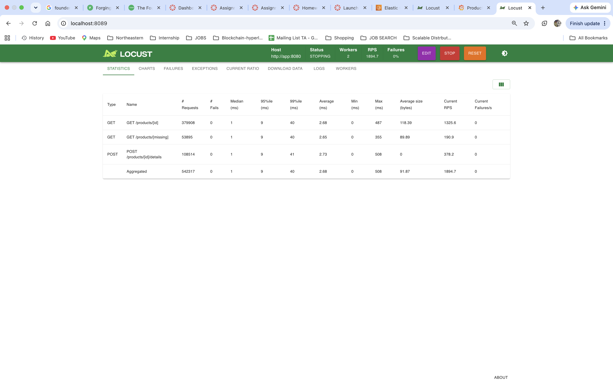
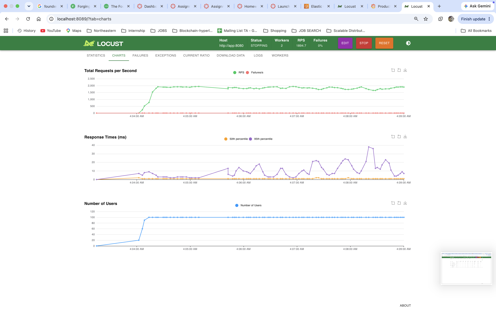

### Logs
One JSON line per request (written in the same middleware as the metrics), to stdout, which goes to CloudWatch
on ECS. Excerpt from the same loaded run (`docker compose logs --no-log-prefix app`):

```json
{"time":"2026-10-18T11:05:51.434332846Z","level":"INFO","msg":"request","method":"GET","endpoint":"/products/:productId","path":"/products/5286730","status":404,"duration_ms":0.007,"client_ip":"172.26.0.4"}
{"time":"2026-10-18T11:05:51.434368804Z","level":"INFO","msg":"request","method":"GET","endpoint":"/products/:productId","path":"/products/659","status":200,"duration_ms":0.002,"client_ip":"172.26.0.4"}
{"time":"2026-10-18T11:05:51.434690471Z","level":"INFO","msg":"request","method":"POST","endpoint":"/products/:productId/details","path":"/products/863/details","status":204,"duration_ms":0.014,"client_ip":"172.26.0.7"}
{"time":"2026-10-18T11:05:51.434700762Z","level":"INFO","msg":"request","method":"GET","endpoint":"/products/:productId","path":"/products/7253592","status":404,"duration_ms":0.005,"client_ip":"172.26.0.4"}
{"time":"2026-10-18T11:05:51.435367054Z","level":"INFO","msg":"request","method":"POST","endpoint":"/products/:productId/details","path":"/products/973/details","status":204,"duration_ms":0.014,"client_ip":"172.26.0.4"}
{"time":"2026-10-18T11:05:51.435386846Z","level":"INFO","msg":"request","method":"GET","endpoint":"/products/:productId","path":"/products/109","status":200,"duration_ms":0.003,"client_ip":"172.26.0.4"}
{"time":"2026-10-18T11:05:51.436483596Z","level":"INFO","msg":"request","method":"GET","endpoint":"/products/:productId","path":"/products/589","status":200,"duration_ms":0.005,"client_ip":"172.26.0.7"}
{"time":"2026-10-18T11:05:51.436569429Z","level":"INFO","msg":"request","method":"GET","endpoint":"/products/:productId","path":"/products/42","status":200,"duration_ms":0.004,"client_ip":"172.26.0.7"}
{"time":"2026-10-18T11:05:51.437531887Z","level":"INFO","msg":"request","method":"GET","endpoint":"/products/:productId","path":"/products/1000","status":200,"duration_ms":0.008,"client_ip":"172.26.0.7"}
{"time":"2026-10-18T11:05:51.438931554Z","level":"INFO","msg":"request","method":"POST","endpoint":"/products/:productId/details","path":"/products/157/details","status":204,"duration_ms":0.014,"client_ip":"172.26.0.4"}
```

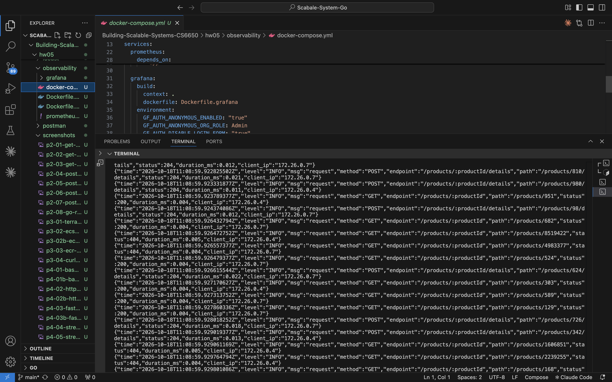

**The same RED signals recovered from the logs alone** (545,046 request lines, 11:04:00 to 11:09:00 UTC):

```bash
L='docker compose logs --no-log-prefix app'
# Rate: requests per endpoint (÷ 300 s ≈ 1,817 req/s overall)
$L | grep '"msg":"request"' | jq -s -c 'group_by(.method+" "+.endpoint) | map({endpoint: (.[0].method+" "+.[0].endpoint), requests: length})'
# → GET /products/:productId 435,941 · POST /products/:productId/details 109,105
# Errors: count per status
$L | grep '"msg":"request"' | jq -s -c 'group_by(.status) | map({status: .[0].status, count: length})'
# → 200: 381,761 · 204: 109,105 · 404: 54,180 (= 9.9% non-2xx)
# Duration: exact percentiles
$L | grep '"msg":"request"' | jq -s -c '[.[].duration_ms] | sort | {p50: .[(length*0.5|floor)], p95: .[(length*0.95|floor)], p99: .[(length*0.99|floor)], max: .[-1]}'
# → p50 0.004 ms · p95 0.033 ms · p99 0.126 ms · max 99.6 ms (one outlier, likely a GC pause or CPU contention on the laptop)
```

### Dashboard vs logs
I look at the **dashboard** to answer "is something wrong right now, and how bad?". It shows aggregated trends
(rate, error %, p95) live and cheaply, and it's what you'd alert on. I look at the **logs** after the fact, to
find *which* requests failed or were slow: the exact path, status, time and client. That is per-request
detail that metrics aggregate away, and it's still there when nobody had Grafana open.

---

## Mock interview notes

**Request flow:** TCP connection → Gin engine matches the route → `observe` middleware starts a timer →
recovery middleware (catches panics → 500) → handler parses and validates `productId` and the body →
`productStore.get/update` takes an RLock/Lock on the map → handler writes JSON or 204 → back in `observe`:
metrics are incremented and the JSON log line is written.

**Scalable design for the whole `api.yaml` (design only):**
- Split into stateless services matching the spec's tags: **Product, Shopping Cart, Warehouse, Payments**.
  Each runs as its own ECS service behind an **ALB** (path-based routing), with autoscaling on CPU/RPS.
- **Products:** read-heavy. A database (DynamoDB keyed by `product_id`, or RDS) with a **Redis/ElastiCache**
  read-through cache, plus a CDN for product pages.
- **Shopping cart:** a key-value store (DynamoDB or Redis) keyed by cart ID, with a TTL for abandoned carts.
- **Checkout** is a multi-step workflow (reserve inventory → charge card → ship). It is coordinated
  asynchronously through a **queue/event bus (SQS/SNS or Kafka)** with a saga and compensating actions
  (release the reservation if payment returns 402). Idempotency keys stop retries from double-charging.
- **Warehouse:** strongly consistent inventory counts (conditional writes or transactions) so that
  `reserve` can't oversell.
- **Payments:** isolated, PCI-scoped, calls the external processor with timeouts and circuit breakers.
- Cross-cutting: API gateway for auth (`ApiKeyAuth`/`BearerAuth` from the spec), plus metrics/logs/traces for
  every service.

**Terraform is declarative:** you describe the desired end state ("an ECS service with 1 task using this
image") and Terraform compares it with its state file and the real cloud, then works out the create/update/delete
plan itself. Imperative means writing the steps ("call CreateCluster, then RegisterTaskDefinition, then…") and
handling ordering, retries and "does it already exist?" yourself. The benefits: applies are **idempotent**
(running `apply` twice changes nothing), `plan` shows a diff before changing anything, the infrastructure is
version-controlled and reviewable, environments are reproducible on any machine, and `destroy` cleans up
everything it created.
