# HW7: Cost Savings?! Sync vs. Async Orders, Worker Scaling, and Lambda

**Utkarsh Sharma** · CS 6650 · Fall 2026 · Experiments run on Nov 7, 2026 (AWS Learner Lab, us-west-2) 
Code and data: [github.com/utkarshsharma19/Building-Scalable-Systems-CS6650/tree/main/hw07](https://github.com/utkarshsharma19/Building-Scalable-Systems-CS6650/tree/main/hw07)

> This is my individual section of the team report. Every number below comes from my own deployment and my own runs; the raw data is in `results/`.

## Summary

| Question | My answer |
|---|---|
| How many times more orders did async accept than sync? | **About 147×**: 48.8 orders/s accepted vs. 0.33 orders/s completed, under the same 20-user flash load. Async replied in 0.1 s (median) vs. 30 s. |
| Max sync throughput with 20 customers / orders lost per second | **0.33 orders/s** (measured 0.33); with 20 orders/s of demand, **~19.7 orders/s are lost** |
| Queue growth with 1 worker / time to clear | **~48.5 msgs/s** measured (59.7/s at 60/s); one hour at 60/s takes **~10,700 min (7.5 days)** to clear, longer than SQS's 4-day retention |
| Processing rate with 5 / 20 / 100 workers | **1.66 / 6.66 / 32.66 orders/s** (theory N/3: 1.67 / 6.67 / 33.3) |
| Minimum workers for no buildup at 60 orders/s | **180** (60/s × 3 s, Little's Law) |
| Lambda cold starts | **5 of 12 invocations**: every *new instance*, both after idle time and when requests overlapped. Init 65–84 ms ≈ **2.2–2.8%** of a 3 s job |
| Should the startup switch to Lambda? | **Yes for the processor, but as SNS → SQS → Lambda**, not SNS → Lambda directly |

## Setup

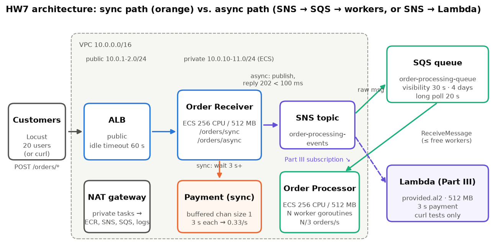

- **Network:** VPC 10.0.0.0/16. Public subnets 10.0.1.0/24 and 10.0.2.0/24 hold the ALB; private subnets 10.0.10.0/24 and 10.0.11.0/24 hold ECS. One NAT gateway lets the private tasks reach ECR, SNS, SQS and CloudWatch.
- **Order Receiver** (ECS, 256 CPU / 512 MB, 1 task):
  - `POST /orders/sync` waits for the simulated payment, then returns 200.
  - `POST /orders/async` publishes to the SNS topic `order-processing-events`, then returns 202.
  - **Simulating the bottleneck:** a goroutine blocked in `time.Sleep` doesn't hold an OS thread, so sleeping alone limits nothing. The payment processor is a buffered channel of size 1: a request must put a token in before its 3 s sleep, so only one payment runs at a time. A unit test checks that N concurrent orders take at least N × delay.
- **Order Processor** (ECS, 256 CPU / 512 MB, 1 task):
  - Long-polls `order-processing-queue` (20 s wait, up to 10 messages) and runs each message in its own goroutine.
  - A semaphore of size `WORKERS` caps concurrent payments.
  - It only asks SQS for as many messages as it has free workers. Otherwise messages would sit in memory past the 30 s visibility timeout and be delivered twice.
- **SQS:** visibility timeout 30 s, retention 4 days, receive wait 20 s. The SNS → SQS subscription uses raw message delivery.
- **Lambda** (Part III): Go on `provided.al2`, 512 MB, subscribed directly to the SNS topic. Its subscription was enabled only for the curl tests.
- **Load:** Locust from my laptop (Boston → us-west-2, about 80 ms round trip), with a 100–500 ms wait between requests.
- **Measurement:** Locust CSVs; `scripts/queue-watch.sh` sampling SQS every 5 s; the processor's own stats log every 10 s; CloudWatch graphs rendered with `get-metric-widget-image`.

## Phase 1: synchronous processing

| Test | Users / spawn rate | Duration | Orders completed | Failures | Throughput | Median / p95 | Average / max |
|---|---|---|---|---|---|---|---|
| Normal | 5 / 1 per s | 30 s | 9 | 0 | 0.33/s | 12 s / 15 s | 10.5 s / 14.7 s |
| Flash sale | 20 / 10 per s | 60 s | 19 | 0 | 0.33/s | 30 s / 56 s | 29.8 s / 56.2 s |

Locust reports "100% success" for both runs, and that's misleading. Locust only counts requests that finish. At the end of the flash test the receiver still had **19 customers waiting in the payment line**, and those requests were dropped, not counted as failures.

**What happens to the customers:** each one waits about (customers ahead of them) × 3 s. With 20 in line that's about 60 s, which is exactly the ALB's idle timeout, so a longer sale would turn into 504 errors. Even the "normal" load of 5 users is too much: the median wait was 12 s for a 3 s payment.

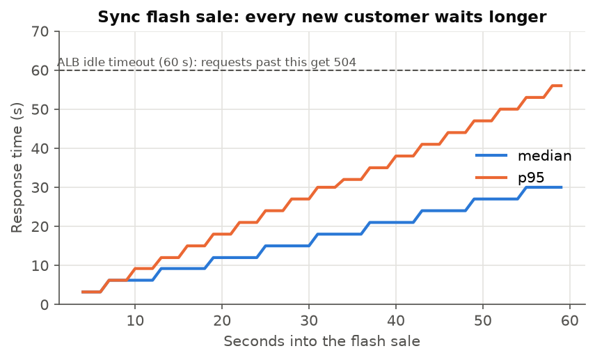

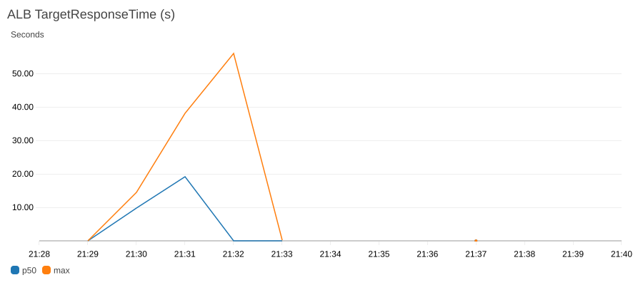

## Phase 2: the bottleneck math

- Payment processor: 1 order per 3 s, so **max throughput = 0.33 orders/s with 20 (or any number of) concurrent customers**.
- Flash-sale demand is 20 orders/s, so **orders lost per second = 20 − 0.33 ≈ 19.7**.
- We can't make payment faster. What we can change is **when we answer the customer**: accept the order immediately and pay in the background.

## Phases 3–4: async with 1 worker

| Test | Orders accepted | Acceptance | Throughput | Median | p95 | Peak queue depth |
|---|---|---|---|---|---|---|
| Async flash sale (20 users, 60 s) | 2,883 | 100% | 48.8/s | 100 ms | 120 ms | 2,897 |

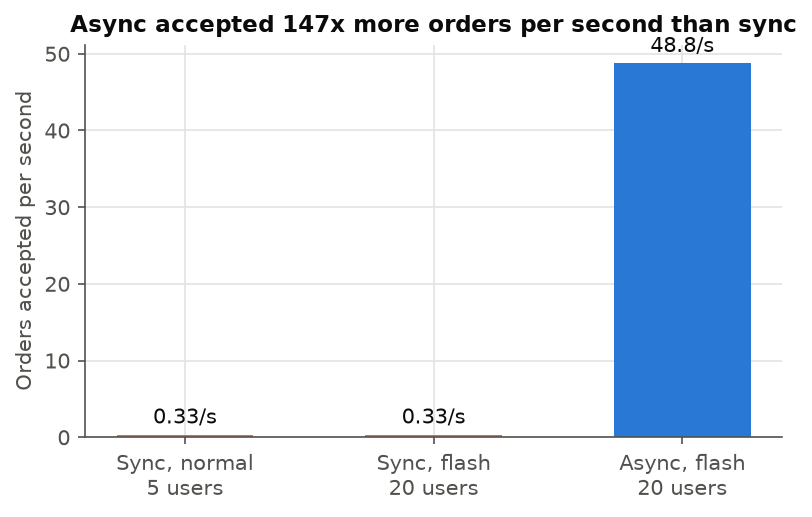

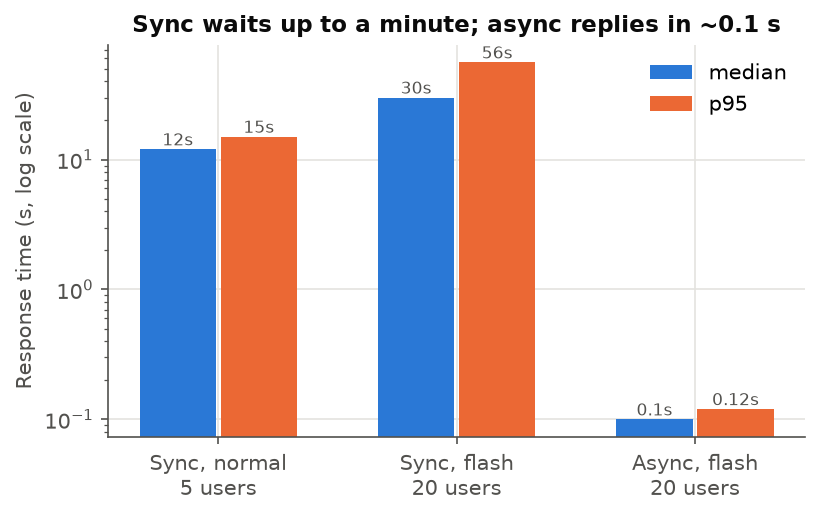

**The queue problem:**
- Acceptance rate: 48.8/s measured (the assignment assumes ~60/s).
- One worker processes 0.33/s, so the queue grows by **≈ 48.5 msgs/s** (59.7/s at 60/s).
- Clearing my 60 s backlog would take 2,897 / 0.33 ≈ **145 min**.
- For the assignment's full hour at 60/s: about 215,000 messages / 0.33 ≈ **10,700 min (7.5 days)**. That's past SQS's 4-day retention, so the oldest orders would be **deleted without ever being processed**. That's a worse failure than the sync 504s, and it happens silently.
- I purged the queue after ~5 minutes of measuring the drain rate; the purge is the cliff at 21:39 in the graph below.

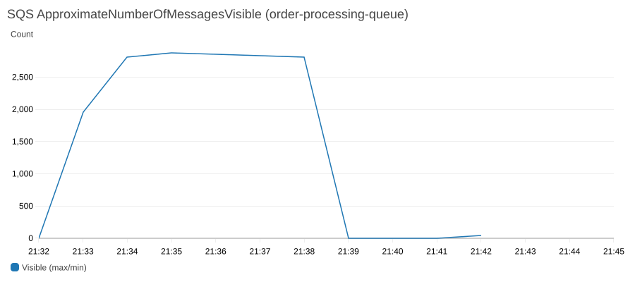

## Phase 5: scaling the workers

The same flash load ran for each worker count: 20 users for 60 s, about 49 orders/s, 100% accepted every time. One processor task, unchanged at 256 CPU / 512 MB; only the `WORKERS` goroutine limit changed.

| Workers | Theory N/3 | Measured rate | Peak queue depth | Queue back to zero | Max CPU | Max memory |
|---|---|---|---|---|---|---|
| 1 | 0.33/s | 0.33/s | 2,897 | ~145 min (computed) | 2.9% | 1.4% |
| 5 | 1.67/s | **1.66/s** | 2,779 | **28.7 min** | 3.4% | 1.6% |
| 20 | 6.67/s | **6.66/s** | 2,441 | **6.9 min** | 8.0% | 1.6% |
| 100 | 33.3/s | **32.66/s** | 837 | **66 s** | 29.3% | 1.6% |

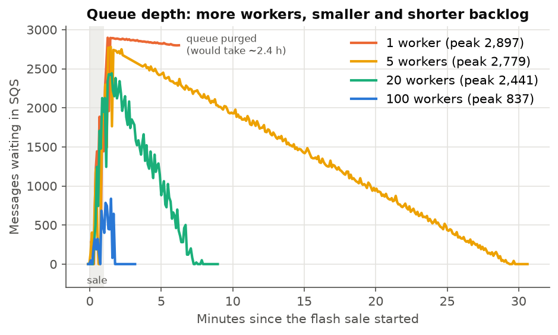

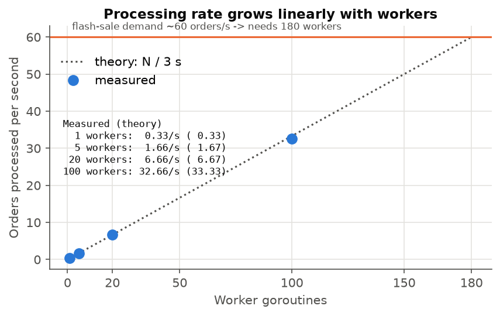

- **The rate is linear in workers:** each worker spends its 3 s waiting, not computing, so N workers complete N/3 orders per second. Drain times match peak ÷ rate (2,779 / 1.67 ≈ 28 min; 2,441 / 6.67 ≈ 6 min).
- **Even 100 workers fall behind** 49/s of arrivals (+16/s during the sale, peak 837), but they clear it about a minute later.
- **Minimum workers to prevent buildup at 60 orders/s = 60 × 3 = 180** (Little's Law: orders in progress = arrival rate × time per order). At my measured 49/s it's 147.
- **The container isn't the limit.** CPU grows with workers only because of SQS receive/delete calls (29% at 100 workers), and memory is flat at ~1.6%. So 180 goroutines fit in one 0.25 vCPU task. The real limit is the 3 s payment provider and how many concurrent payments it allows.

CloudWatch, 20 workers: queue depth spikes during the sale and drains over about 7 minutes; messages sent vs. deleted; processor CPU and memory.

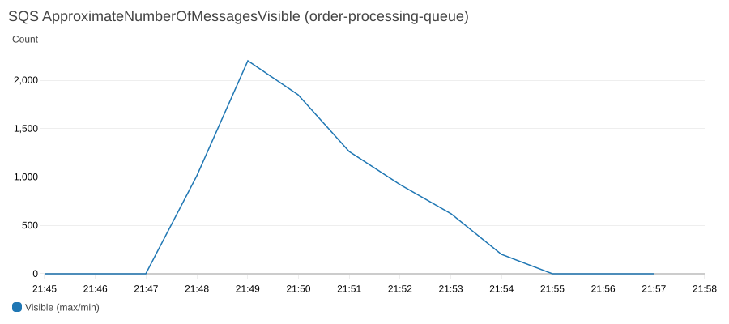

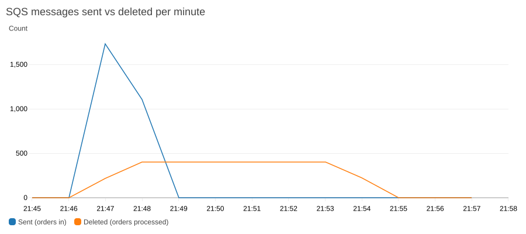

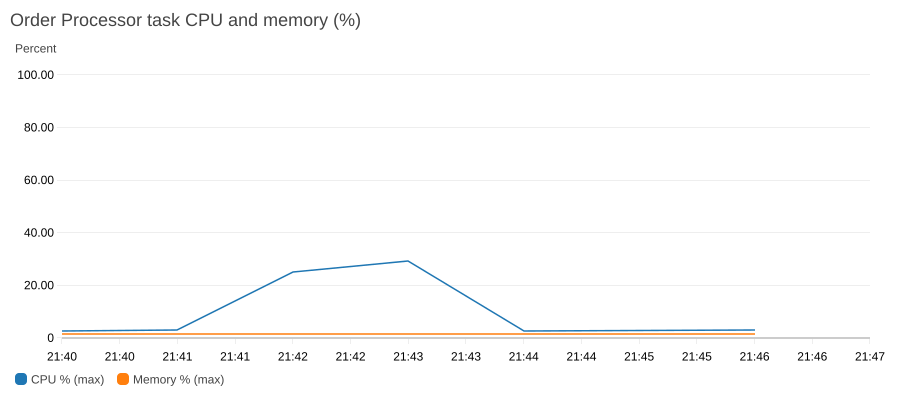

More graphs for every run are in `screenshots/`: `p5-w5-*`, `p5-w100-*` and `p3-async-w1-*`.

## Part III: replacing the workers with Lambda

I deployed the Lambda subscribed directly to the Part II SNS topic and sent 12 orders with curl through `/orders/async`. There was no Locust while it was subscribed.

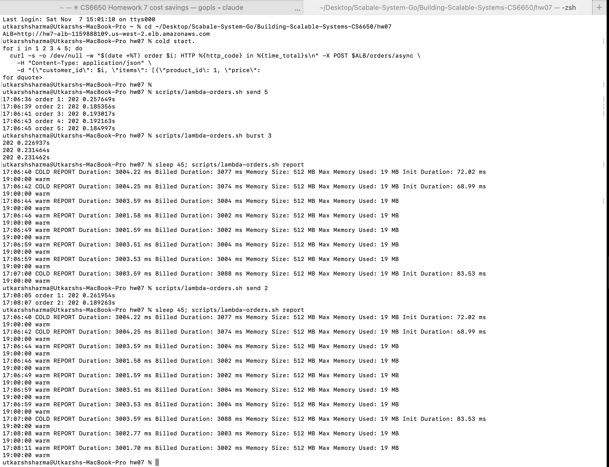

| Time | Request | Start | Billed | Init Duration |
|---|---|---|---|---|
| 17:06:40 | order 1 | **cold** | 3,077 ms | 72.0 ms |
| 17:06:42 | order 2 (2 s later) | **cold** | 3,074 ms | 69.0 ms |
| 17:06:44–49 | orders 3–5 | warm | 3,002–3,004 ms | — |
| 17:06:59 | burst of 3: two of them | warm | 3,004 ms | — |
| 17:07:00 | burst of 3: the third | **cold** | 3,088 ms | 83.5 ms |
| 17:08:08–11 | 2 orders ~1 min later | warm | 3,002–3,003 ms | — |
| 17:21:10 | after 13 min idle | **cold** | 3,068 ms | 64.9 ms |
| 17:21:13 | 2 s later | **cold** | 3,078 ms | 73.3 ms |

**How often do cold starts occur?** On every *new instance*. That happens in two situations:
1. **After idle time:** after 13 idle minutes, all three warm instances had been reclaimed.
2. **When requests overlap:** Lambda runs one event per instance. Order 2 arrived while order 1 was still in its 3 s payment, so Lambda started a second (cold) instance even though one was warm 2 s earlier.

With 3 s jobs, any arrival rate above 1 order every 3 s needs more instances, and during a flash sale Lambda would add cold instances until it reached about 180.

**Overhead:** 65–84 ms of init on 3,000 ms ≈ **2.2–2.8%**, and it's billed. The function used 19 MB of its 512 MB. **It doesn't matter here:** the customer already got their 202, and this is background work. It would matter on a path with a ~100 ms latency budget. SNS → Lambda delivery added about 0.1 s warm and 0.3–0.4 s cold.

### Cost reality check

Measured cost per order ≈ 3.0 s × 0.5 GB = **1.5 GB-s**.

| Orders / month | GB-s | Lambda | ECS processor (always on) |
|---|---|---|---|
| 10,000 | 15,000 | **$0** (free tier) | ~$9 |
| 100,000 | 150,000 | **$0** | ~$9 |
| 266,667 | 400,000 (free tier used up) | **$0** | ~$9 |
| 1,000,000 | 1,500,000 | ~$18.33 | ~$9 |

- **My expected volume:** a startup doing 10k–100k orders/month, plus a few flash-sale hours (216k orders each at 60/s), pays **$0** for Lambda.
- **Break-even with the assignment's $17/month:** (17 / 0.0000166667 + 400,000) / 1.5 ≈ **945,000 orders/month**. The assignment's "~1.7M" overstates it: at 1.7M orders Lambda costs about $36, because GB-seconds dominate and the request charge is only $0.14.
- **The saving is smaller than "$17":** Lambda replaces only the processor. The receiver task (~$9) and the ALB (~$16) stay. The biggest line in the Part II design is the **NAT gateway (~$33/month plus data)** that private subnets require, so the whole stack is about $65–70/month at list price. (These are approximate us-west-2 list prices; I didn't fetch an invoice.)

### Recommendation: switch, but keep a queue

**What we gain with Lambda:**
- $0 at our volume.
- Nobody tunes worker counts at 3 am (the "180 goroutines" decision disappears).
- No processor to health-check.
- A 2–3% cold-start cost on background work.

**What we lose with direct SNS → Lambda:**
- A failed order gets 2 retries and is then dropped.
- No backlog to replay, no visibility timeout, no batching.
- A flash sale needs about 180 concurrent executions. My account's limit is 400, so it fits, but nothing protects the payment provider from 180 simultaneous calls.

**What I'd ship: SNS → SQS → Lambda (SQS event source).** It keeps SQS's durability, 4-day retention and a dead-letter queue. Lambda still scales automatically, and the event source's maximum concurrency caps parallel payments at what the provider allows. That's the serverless savings without giving up the guarantees Part II gave us.

## Sync vs. async in production

- **Sync** when the caller needs the result to continue and the work is fast and reliable: logins, reading a product page, checking inventory, or the payment authorization itself if the customer must see "approved" before leaving the page.
- **Async** when the work is slow, bursty, or done by a third party, and the caller only needs "accepted": order fulfilment, payment capture, emails, image processing.
- **Queue buildup** is arrival rate > processing rate. Prevent it by:
  - sizing workers by Little's Law,
  - autoscaling on `ApproximateNumberOfMessagesVisible` (or the backlog per worker),
  - alarming on queue age, not just depth,
  - adding a DLQ for poison messages,
  - and, if the downstream can't go faster, rate-limiting or shedding load at the API with a clear "we'll email you" message.

## Team comparison

*(To fill in with teammates' results: one row per person for the same tests. Where results match and differ, and why: region, where Locust ran from, the Locust machine, payment-channel implementation, number of processor tasks.)*

| Metric | Utkarsh | Teammate 2 | Teammate 3 |
|---|---|---|---|
| Sync flash throughput | 0.33/s | | |
| Sync flash average / max response | 29.8 s / 56.2 s | | |
| Async flash acceptance (orders/s) | 48.8/s | | |
| Peak queue depth, 1 / 5 / 20 / 100 workers | 2,897 / 2,779 / 2,441 / 837 | | |
| Time to empty, 5 / 20 / 100 workers | 28.7 min / 6.9 min / 66 s | | |
| Lambda cold starts / init duration | 5 of 12 / 65–84 ms | | |

## Reproducing

See `README.md`. In short: `terraform apply`, then `scripts/run-test.sh`, `scripts/phase5.sh 100 20 5`, `scripts/lambda-orders.sh`, `scripts/cw-snapshot.sh`, `scripts/plot.py`. Finish with `terraform destroy`.

Lessons from running it:
- A Desktop folder synced by iCloud evicted the Terraform provider binary and Python packages mid-session; keep them outside it.
- The kreuzwerker Docker provider 2.x needs Docker Desktop's socket path on macOS, and doesn't re-push a rebuilt image unless the push resource has a `triggers` entry.
